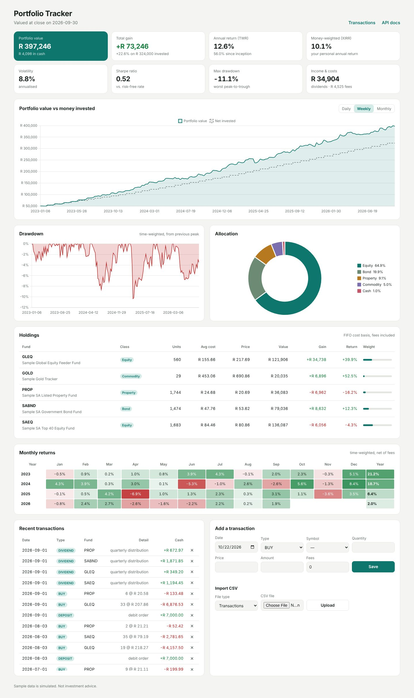
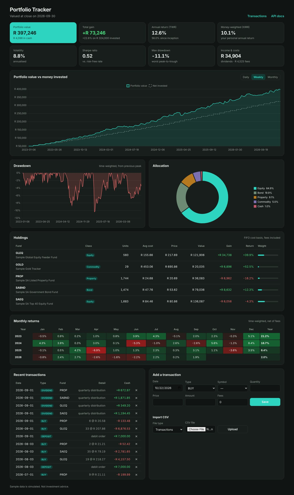

# Portfolio Tracker

A FastAPI web app for tracking an investment portfolio. Import your trades, and it works out what you own, what it cost, what it is worth, and how well it has actually performed. The performance figures use the same methods fund managers report with.



## Features

- **Holdings with FIFO cost basis.** Brokerage fees are folded into each lot's unit cost, so unrealised and realised P&L are net of costs.
- **Two kinds of return, done properly**
  - **Time-weighted return (TWR)** strips out the effect of when you deposited money. It measures the investments, not your timing, and is the figure funds publish.
  - **Money-weighted return (XIRR)** is your personal annual return, given the timing and size of your deposits and withdrawals.
- **Risk:** annualised volatility, Sharpe ratio (against a configurable risk-free rate), max drawdown and a drawdown chart.
- **Monthly returns heatmap** and allocation by asset class.
- **CSV import** for instruments, prices and transactions. Imports are *all-or-nothing*, with row-level error messages, and every import replays the full history so you can't save a sell of units you don't own or spend cash you don't have.
- **REST API** with interactive OpenAPI docs at `/docs`.
- Works on **SQLite** (zero setup) or **PostgreSQL** (Docker Compose), with light and dark mode and a mobile-friendly layout.



## Quick start

```bash
python -m venv .venv && source .venv/bin/activate
pip install -r requirements.txt
uvicorn app.main:app --reload
```

Open http://localhost:8000. On first start it loads ~3.7 years of sample data (five fictional unit-trust style funds with simulated prices) so there is something to look at. Set `PT_LOAD_SAMPLE_DATA=false` to start empty.

**With Docker + PostgreSQL**

```bash
docker compose up --build
```

## CSV formats

| File | Columns |
|---|---|
| `instruments.csv` | `symbol, name, asset_class` (Equity / Bond / Property / Commodity / Cash) |
| `prices.csv` | `date, symbol, close`. Re-importing updates existing closes. |
| `transactions.csv` | `date, type, symbol, quantity, price, amount, fees, note` |

Transaction types: `DEPOSIT`, `WITHDRAWAL`, `BUY`, `SELL`, `DIVIDEND`, `FEE`. Buys and sells use `quantity` × `price`, and the rest use `amount`. See [`sample_data/`](sample_data) for examples.

## API

| Method | Endpoint | |
|---|---|---|
| GET | `/api/summary` | Value, gains, income, fees, TWR, XIRR, volatility, Sharpe, max drawdown |
| GET | `/api/holdings` | Positions with cost basis, P&L and weights |
| GET | `/api/allocation` | Value by asset class |
| GET | `/api/timeseries?freq=D\|W\|M` | Portfolio value, net invested, TWR index, drawdown |
| GET | `/api/monthly-returns` | Compounded TWR per month |
| GET/POST/DELETE | `/api/transactions` | List, add (validated against the full history), delete |
| GET/POST | `/api/instruments` | List, add |
| POST | `/api/import/{instruments,prices,transactions}` | CSV upload |

## How the numbers are calculated

All the maths lives in [`app/services/portfolio.py`](app/services/portfolio.py). It is pure Python and pandas with no database, so it is unit-tested directly.

- **Daily TWR:** `r_t = (V_t − F_t) / V_{t−1} − 1`, where `F_t` is the day's external cash flow. Trades settle at the close, so money deposited today has not earned anything yet (the end-of-day convention). Daily returns are chained, then annualised.
- **XIRR:** deposits are negative flows, withdrawals positive, and today's value is the final positive flow. The rate that makes NPV = 0 is found by bisection.
- **Drawdown** is measured on the TWR index, not on portfolio value, so new deposits can't hide a loss.
- **Volatility** is the standard deviation of daily returns × √252. **Sharpe** is (annualised TWR − risk-free) ÷ volatility.
- Transactions on weekends and holidays are valued from the next trading day. Within a day, cash comes in (deposits, dividends, sales) before it goes out (fees, buys, withdrawals).

## Tests

```bash
pip install -r requirements-dev.txt
pytest
```

There are 21 tests. They cover FIFO P&L with fees, overselling and overspending, same-day ordering, a TWR case built so deposits must not affect the return, weekend valuation, drawdown, XIRR (NPV = 0), monthly compounding, and the API end to end: all-or-nothing imports, upserts, and deletes blocked when they would break the history.

## Configuration

| Variable | Default | |
|---|---|---|
| `PT_DATABASE_URL` | `sqlite:///./portfolio.db` | Any SQLAlchemy URL (`postgresql+psycopg2://…`) |
| `PT_BASE_CURRENCY` | `ZAR` | Display currency |
| `PT_RISK_FREE_RATE` | `0.08` | Annual rate for the Sharpe ratio |
| `PT_LOAD_SAMPLE_DATA` | `true` | Load the demo portfolio when the database is empty |

Sample data is simulated, and nothing here is investment advice.
